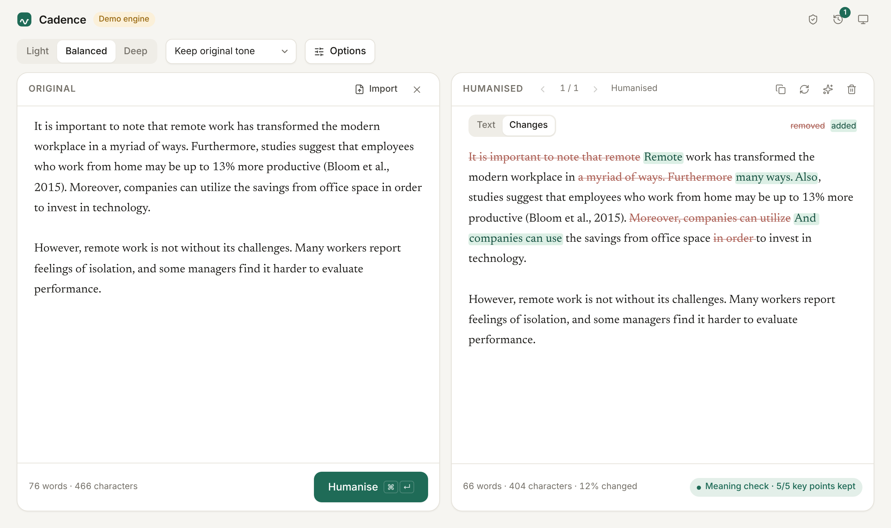

# Cadence — an AI text humaniser that keeps your meaning

Cadence rewrites text so it reads as fluent, natural writing by a skilled person, in the tone you choose, and then **checks the rewrite against the original** before you see it. It's built for essays, academic and technical writing, reports, emails and everyday messages.

The engine aims for *genuinely better writing*: cutting formulaic phrasing, monotonous rhythm and filler. It doesn't rely on synonym swaps, sprinkled contractions or deliberate errors, and it is **not** tuned against AI detectors (see [Limitations](#limitations)).



*Screenshot taken with the demo engine (see [Testing](#testing)).*

---

## Quick start

Requirements: Node.js 20+ and an Anthropic API key.

```bash
cd humaniser
npm install
cp .env.example .env.local      # then set ANTHROPIC_API_KEY=...
npm run dev                     # http://localhost:3000
```

Production: `npm run build && npm start`.

Without a key, the app starts and shows a clear **"AI engine not configured"** state. The Humanise button is disabled and the API returns `503 not_configured`. It never fakes output.

### Configuration (`.env.local`)

| Variable | Default | Purpose |
|---|---|---|
| `ANTHROPIC_API_KEY` | (required) | Server-side only; never sent to the browser. |
| `HUMANISER_MODEL` | `claude-opus-5-5` | Rewrite and correction model. `claude-sonnet-5-5` is cheaper and faster, with some quality cost. |
| `HUMANISER_VERIFY_MODEL` | same as above | Model for the meaning-verification step. |
| `HUMANISER_RATE_LIMIT_PER_MIN` | `12` | Requests per client per minute. |
| `HUMANISER_MAX_CONCURRENT` | `2` | Concurrent requests per client. |
| `HUMANISER_MOCK` | off | `1` turns on a deterministic **demo engine** for automated tests. The UI shows a "Demo engine" badge whenever it is on. |

---

## Features

- **Rewrite intensity**: Light (keeps your wording), Balanced (default), Deep (restructures freely).
- **12 tones**: Keep original, Natural, Conversational, Academic, Formal, Professional, Casual, Analytical, Persuasive, Concise, Sophisticated, Clear. Each one maps to concrete style guidance in the prompt, and the request-payload tests confirm the selected tone reaches the engine.
- **Options**: British, American or source spelling; output language; length (same, shorter, longer, or a target word count); keep paragraph structure; keep technical terms; "never change" phrases; custom instructions with one-click presets.
- **Streaming output** with a three-step progress indicator: *Rewrite → Check meaning → Refine*.
- **Meaning check**: a badge shows how many key points were kept and opens a report with key points, reviewer notes, automated checks, and style metrics before and after. Every rewrite gets this check.
- **Changes view**: a word-level diff with semantic clean-up, so restructured phrases show as readable "was → now" blocks rather than scattered single-word changes.
- **Sentence-level rewriting**: click any output sentence to get three faithful alternatives, optionally with your own instruction, then swap one in.
- **Versions and undo**: Alternatives, Humanise again and sentence edits all become versions. Use ‹ › to undo or redo, and the History drawer to reopen earlier texts from the same session.
- **Import** `.txt`, `.md` and `.docx` files by picker or drag-and-drop. Files are parsed **in the browser** and never uploaded.
- Copy, clear, cancel an in-flight request, ⌘/Ctrl+Enter to submit.
- Light, dark and system themes; a responsive layout with tabs on phones; keyboard-accessible controls.

---

## Architecture

```
humaniser/
├─ src/app/
│  ├─ page.tsx, layout.tsx, globals.css   UI shell + design tokens (light/dark)
│  └─ api/
│     ├─ humanise/route.ts   POST → NDJSON stream of pipeline events
│     ├─ sentence/route.ts   POST → 3 alternatives for one sentence
│     └─ status/route.ts     GET  → is the engine configured? (no secrets)
├─ src/lib/engine/           the humanisation engine (framework-independent)
│  ├─ options.ts     settings schema (zod), shared by client and server
│  ├─ prompts.ts     system prompts and request builders for every stage
│  ├─ pipeline.ts    rewrite → verify → correct orchestration
│  ├─ fidelity.ts    deterministic meaning checks (numbers, quotes, citations…)
│  ├─ style.ts       evidence-based style metrics
│  ├─ provider.ts    Anthropic provider (streaming, structured output, errors)
│  └─ mockProvider.ts  deterministic demo engine for tests
├─ src/lib/diff.ts           Myers word diff + semantic clean-up
├─ src/components/           Workspace, panels, report, sentence editor…
├─ tests/unit/               Vitest: engine, checker eval, provider transport
├─ tests/e2e/                Playwright: real browser against production build
└─ eval/                     20-category dataset + live engine evaluation
```

**Stack**: Next.js 15 (App Router) with TypeScript, Tailwind CSS v4, the official `@anthropic-ai/sdk`, zod, jsdiff and mammoth, tested with Vitest and Playwright. One deployable app with server-side API routes keeps the key off the client and works on Vercel or any Node host.

### The rewriting pipeline

Each **Humanise** request runs through these stages:

1. **Local analysis**, instant. `style.ts` measures the source: sentence-length spread, repeated openers, transition stacking, stock vocabulary, formulaic phrases, trailing participial clauses and nominalisation density. The findings go to the model as *hints to verify*, not commands.
2. **Rewrite**, streamed. Claude gets a fixed, cached system prompt with the priority order, the fidelity rules and a natural-writing guide, plus per-request `<settings>` and the text inside `<source_text>`. Adaptive thinking covers the brief's analysis stages (message, claims, numbers, hedges, audience, and what actually needs work) before the model writes. Effort follows intensity: Light → `low`, Balanced → `medium`, Deep → `high`.
3. **Verify**, in two layers:
   - *Deterministic checks* (`fidelity.ts`). **Hard** failures cover numbers, units, percentages and times that are missing, changed or invented; altered quotations; dropped citations; changed links; changed protected phrases; and changed paragraph count. **Heuristic warnings** cover new absolute words or dropped hedges ("may" → "will"), correlation turned into causation, changed negation or condition counts, lost terms or names, and length drift.
   - *AI review*, with structured output. A separate prompt compares the original and the rewrite, confirms or dismisses each automated warning, lists the key points with a status for each, and rates issues as critical, major or minor.
4. **Correct**, at most 2 passes. Any hard failure or critical/major issue triggers a targeted correction that fixes *only* the listed problems. The rewrite is then verified again. The best candidate (fewest blocking problems) is delivered, so a bad correction can't make things worse.
5. **Deliver**: clean text, no preamble, plus the report.

If the review step fails because the provider is overloaded, the rewrite is still delivered and marked *"Automated checks only"*, never shown as verified.

### Model choice

- **Rewrite and verify**: `claude-opus-5-5` with adaptive thinking. Fidelity is the top priority, and Opus is the most reliable current model at following nuanced editing constraints. At $4 / $20 per million tokens, a 300-word Balanced rewrite with verification is *estimated* at roughly 5–15 cents. Output and thinking tokens dominate the cost, so run `npm run eval` to measure it. Sampling parameters (`temperature`) are not accepted by current models, so **alternatives** are produced by sending earlier versions and asking for different choices, not by re-rolling randomness.
- **Server-side refusal fallback** (`fallbacks: "default"`) is on. If a safety classifier wrongly declines a benign text, the API retries on Anthropic's recommended fallback model within the same call. You can switch to `claude-sonnet-5-5` with one environment variable.
- **Structured outputs** (`output_config.format` with a zod schema) give schema-valid verification reports and sentence alternatives.

### Research notes (what informed the engine)

| Finding | Source | How it is used |
|---|---|---|
| Instruction-tuned LLMs use present-participial clauses at roughly 2–5× and nominalisations at roughly 1.5–2× the human rate. Differences persist as models get larger. | Reinhart et al., *Do LLMs write like humans?*, PNAS 2025 ([arXiv:2410.16107](https://arxiv.org/abs/2410.16107)) | Prompt guidance plus measured metrics (trailing "-ing" clauses, nominalisations per 100 words). |
| After LLMs arrived, a stock "excess vocabulary" (delves, showcasing, underscores…) spiked in scientific abstracts. | Kobak et al. 2024, *Delving into ChatGPT usage in academic writing through excess vocabulary* ([arXiv:2406.07016](https://arxiv.org/abs/2406.07016)) | Stock-word lexicon. Replaced only when used as filler, kept when technical ("robust standard errors"). |
| n-gram overlap metrics handle negation and synonyms poorly; NLI-style bidirectional checks preserve content better. | Babakov et al., ACL SRW 2022 | No BLEU/ROUGE. Meaning is checked by an entailment-style AI review plus targeted checks. |
| NLI and paraphrase systems fail disproportionately on negation and numbers; paraphrasers often lose numbers and units. | Naik et al. 2018 (stress tests); ParaQD 2022 | Dedicated deterministic checks for numbers, units, negation, conditions and certainty. |
| Uniform sentence length ("low burstiness") is a popular claim with weaker evidence. | — | Shown as a descriptive metric and a soft hint only. The prompt says to vary rhythm with the content, never randomly. |

Popular tricks with no evidence of improving writing (inserting contractions, typos, random synonyms) are **explicitly prohibited** in the prompt.

---

## Security and privacy

- The API key exists only on the server. The browser calls only same-origin routes, enforced by a strict Content-Security-Policy (`connect-src 'self'`, `frame-ancestors 'none'`), plus `X-Frame-Options`, `nosniff`, `Referrer-Policy: no-referrer` and no `X-Powered-By`.
- **Prompt-injection boundary**: user text is wrapped in `<source_text>`, any delimiter tags inside it are neutralised, and the system prompt treats everything inside as material to edit, never as instructions. Custom instructions sit in a separate `<user_preferences>` block and cannot override the fidelity rules.
- **Validation**: a zod schema covers every request. The server enforces a 20,000-character text limit, a 200 KB body limit, length limits on custom instructions and phrases, and JSON-only content types.
- **Abuse limits**: per-client rate and concurrency limits (in memory, keyed by a hash of the client IP), a 285 s pipeline deadline, SDK timeouts and retries, and cancellation propagated from the browser to the provider call.
- **No text storage**: the server never logs or stores submitted text; logs record only error types. History lives in React state, so it disappears when the tab closes. Only *settings* are saved in `localStorage`. Imported files are parsed in the browser.
- Provider errors are mapped to friendly messages and internal details are never forwarded. A test asserts that provider error text is not leaked.

> Rate limiting is in-memory and per instance. For a multi-instance deployment, put it on a shared store (e.g. Redis) and deploy behind a proxy that sets `X-Forwarded-For`.

---

## Testing

```bash
npm test             # unit tests + checker evaluation (Vitest)
npm run test:e2e     # production build + Playwright browser tests
npm run lint && npm run typecheck
npm run eval         # live engine evaluation (needs ANTHROPIC_API_KEY; costs money)
npm run eval -- --judge          # plus a blind, order-randomised pairwise judge
npm run eval -- --mock           # smoke-test the harness itself
```

### What was actually run while building this

All results below come from real runs in the development container.

| Suite | Result |
|---|---|
| Unit tests (Vitest): text utilities, prompts, validation, diff, style metrics, fidelity checker, pipeline control flow | **116 passed** |
| Pipeline control flow (scripted fake model): clean pass; correction after a changed number; stopping at the 2-pass cap and keeping the best candidate; reviewer-flagged major issue; review outage degrading to "unverified"; empty output becoming an error | all pass |
| Real `AnthropicProvider` against a fake HTTP transport: exact wire request (model, beta header, `fallbacks`, adaptive thinking, effort, cached system prompt, no deprecated parameters), SSE assembly, structured-output parsing, refusal and `max_tokens` handling, HTTP 400/401/429/500/529 mapping with no leakage | all pass |
| **Checker evaluation** on the 20-category dataset (`eval/dataset.json`, each sample with a hand-written faithful reference rewrite) | identity: 0 findings · faithful references: **0 hard false alarms**, 6 heuristic warnings (sent to the AI reviewer) · systematic corruptions (changed number, removed hedge, dropped negation, dropped citation, altered quote, dropped condition, correlation → causation): **25/25 detected** |
| E2E (Playwright, Chromium, production build): validation, streaming and stages, report, Ctrl+Enter, settings reaching the API and persisting, alternatives, undo/redo, humanise again, changes view, sentence rewrite and undo, copy, clear, provider error and retry, cancel, `.txt` and `.docx` import plus rejection of unsupported files, history, theme persistence, keyboard operation, security headers, API validation, unconfigured server, mobile layout (Pixel 7) with no horizontal overflow; zero console errors or CSP violations in every test | **20 passed**, stable over 3 repeats |
| Manual visual review with screenshots: desktop light and dark, tablet (820 px), phone (390 px) | reviewed and fixed (see below) |

Problems found and fixed during these runs:

- The checker missed correlation → causation when the source already mentioned causation hypothetically. It now compares counts of causal wording.
- Clock times ("3 pm" vs "3:00 pm") were read as different numbers, and a first fix wrongly treated decimals like "3.25" as times. Both are now covered by tests.
- In translation mode, locale number formats (3.5 → 3,5) would have forced impossible corrections. Number findings now become warnings when translating.
- A trailing newline leaked into the live stream.
- The serif reading font wasn't applied.
- The Options popover overflowed the screen on phones.
- Text typed before React hydrated was ignored.
- The rate-limit key stored raw IPs despite the privacy claim. It now stores a hash.
- The `.env*` ignore rule would have excluded `.env.example`.

### Not yet tested: the live model

The build container had **no Anthropic API key**, so the real model's rewriting quality has **not** been measured here. Everything about the engine that can be checked without the model has been: prompts, request shape, streaming, parsing, error handling, the verify/correct loop and the fidelity checks. To measure the live engine, run:

```bash
ANTHROPIC_API_KEY=... npm run eval -- --judge
```

This writes `eval/results/<timestamp>.md`, which includes every original and output for human review, plus objective fidelity failures, reviewer verdicts, latency (p50 and p90) and blind-judge preferences. Start your prompt tuning from those outputs.

---

## Limitations

- **No guarantees about AI detectors.** Cadence improves writing quality; it doesn't target detector scores, and detector results are unreliable anyway. Use it to improve your own writing, within the rules of your school, publisher or workplace.
- **Verification is strong but not perfect.** The AI reviewer comes from the same model family as the rewriter, so it can share blind spots. The deterministic checks are deliberately narrow. The UI says so, and you should read important text yourself.
- **Latency**: rewrite plus verification typically takes several seconds to tens of seconds. A correction pass adds more, bounded at two passes and a 285 s deadline.
- **Limits**: 20,000 characters per request. Longer documents should be split. Text is never silently truncated.
- **Formats**: `.docx` import is plain text only; formatting is dropped.
- History is per tab and in memory only. That's deliberate, for privacy.
